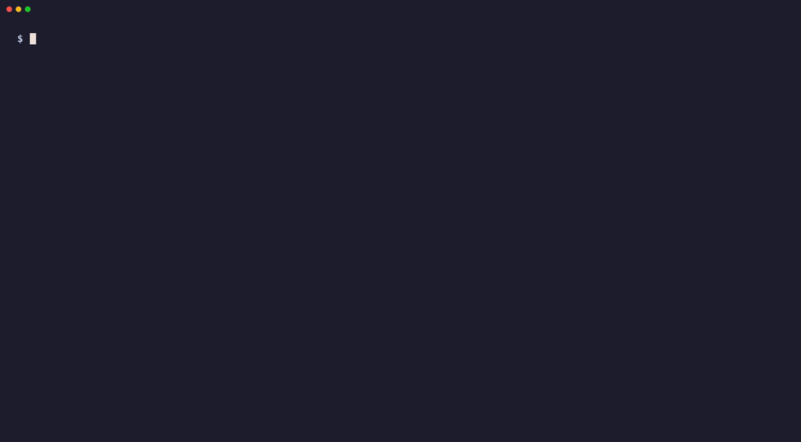
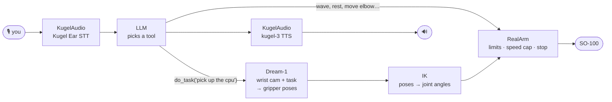

# so100-voice

**Talk to a real robot arm.** A LiveKit voice agent drives an [SO-100](https://github.com/TheRobotStudio/SO-ARM100) arm:
the LLM handles simple moves itself and hands hands-on tasks like *"pick up the CPU"* to Dream Labs' **Dream-1**,
which plans from the wrist camera. Plain code converts every plan into joint angles and checks them before a motor moves.



<sub>Scripted re-enactment of a session (<code>docs/demo/replay.py</code>), rendered with <a href="https://github.com/charmbracelet/vhs">VHS</a>.</sub>

## How it works



- **Voice:** [LiveKit Agents](https://docs.livekit.io/agents/). KugelAudio does speech-to-text, turn detection, noise filtering and the voice.
- **The LLM decides what to do** and composes simple motions from a description of each joint (meaning, direction, safe range). There are no hard-coded gestures.
- **Dream-1 decides how to grasp.** Every few seconds it gets the last wrist-camera frames, the task and the gripper's current pose, and answers the next 48 gripper poses (2.4 s of motion).
- **Code owns safety, never the model.** Our own FK/IK from the URDF turns poses into joint angles. `RealArm` validates every target against the calibrated limits, caps speed (25°/s while following a plan), holds the arm when the camera frame is stale, and stops within one tick when you say "stop". The keyword is caught in the live transcript, before the LLM even sees it.

## Run it

Needs Python 3.12, [uv](https://docs.astral.sh/uv/), the [LiveKit CLI](https://docs.livekit.io/home/cli/) and a KugelAudio key.

```bash
uv sync
cp .env.example .env.local          # fill in LiveKit + KugelAudio keys
uv run python src/demo.py           # 3D arm in Rerun, no voice, no hardware
lk agent console                    # talk to it (fake robot + Rerun by default)
```

**Real arm:** calibrate with LeRobot, set `ROBOT=real` and `ROBOT_PORT` in `.env.local`, then
run `uv run python src/check_mapping.py`. It's read-only: move the arm by hand and the 3D model must follow.
For `do_task`, put a [Dream Labs API key](https://platform.dreamlabs.ai/api-documentation/) in `~/.dreamlabs/credentials`.

```bash
uv run pytest                       # simulated arm + LLM behaviour tests
```

## Code

| File | What |
| --- | --- |
| `src/agent.py` | Voice agent: STT, LLM, TTS, instant "stop" keyword |
| `src/real_assistant.py` | Tools for the real arm: `move_joints`, `run_motion`, `go_to_pose`, `do_task`, `stop` |
| `src/real_arm.py` | Hardware layer: validation, smoothstep glides, streaming `follow()`, hold on stop |
| `src/dream_task.py` | Dream-1 loop: camera thread, async calls, chunk timing, IK per row |
| `src/so100_kinematics.py` | FK/IK from the URDF; calibrated degrees ↔ URDF radians ↔ Dream frame |
| `src/robot.py` | `FakeRobot` + Rerun 3D view |
| `src/real_manual.py` | Drive the real arm by typing joint commands, save poses |
| `docs/real-arm.md` | Everything measured on the physical arm: calibration, directions, limits |

## Status

Voice control of the real arm runs on hardware: poses and LLM-composed motions, with limit checks.
The Dream-1 path is built and tested against a simulated arm with the real camera and the real API,
and the first hardware run is next. Dream-1 was trained on another arm, so on the SO-100 it runs zero-shot.

## Credits

- Arm model (URDF + meshes in `assets/so100/`): [TheRobotStudio/SO-ARM100](https://github.com/TheRobotStudio/SO-ARM100), Apache-2.0
- [LeRobot](https://github.com/huggingface/lerobot) for the servo bus and calibration
- [LiveKit Agents](https://github.com/livekit/agents), [KugelAudio](https://kugelaudio.com), [Dream Labs](https://dreamlabs.ai), [Rerun](https://rerun.io)

MIT licensed, except `assets/so100/` (Apache-2.0).
